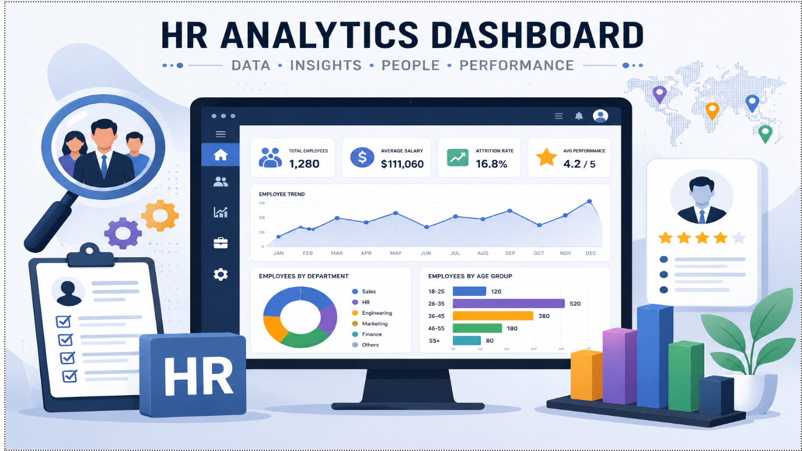
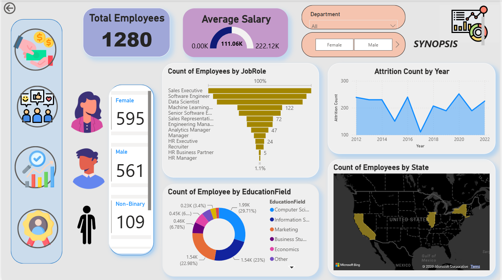

# 📊 Workforce Performance Analytics

An end-to-end HR Analytics project built using **Python**, **MySQL**, and **Power BI** to analyze employee performance, salary distribution, employee satisfaction, promotions, and attrition.

The project follows a complete data analytics workflow—from data cleaning and exploratory data analysis (EDA) using Python, business analysis using SQL, to building an interactive multi-page Power BI dashboard for HR decision-making.

---

# 📖 Project Overview

Organizations collect a large amount of employee data every day, but transforming that data into meaningful business insights is often challenging.

This project demonstrates how HR data can be transformed into actionable insights using modern data analytics tools. The workflow includes data cleaning with Python, business analysis using MySQL, and interactive dashboard development in Power BI.

The dashboard enables HR professionals to monitor workforce performance, salary trends, employee satisfaction, promotions, performance ratings, overtime, and attrition through interactive visualizations.

---

# ✨ Project Highlights

- End-to-end HR Analytics project following the complete analytics lifecycle.
- Cleaned and transformed raw HR datasets using **Python (Pandas)**.
- Performed Exploratory Data Analysis (EDA) to identify workforce patterns.
- Used **MySQL** to solve business problems through SQL queries.
- Implemented Joins, CTEs, Window Functions, Aggregate Functions, and Ranking Functions.
- Built an interactive **6-page Power BI Dashboard**.
- Designed KPI Cards, Gauge Charts, Bing Maps, Navigation Buttons, and Interactive Slicers.
- Created an Employee Profile page for individual employee analysis.
- Generated business insights to support data-driven HR decisions.

---

# 🎯 Project Objectives

The objectives of this project are to:

- Clean and prepare HR datasets using Python.
- Perform exploratory data analysis (EDA).
- Analyze employee performance and salary trends using SQL.
- Identify workforce trends related to attrition, promotions, and satisfaction.
- Build an interactive dashboard for HR decision-making.
- Present insights through dynamic Power BI visualizations.
---

# 📂 Repository Structure

```text
Workforce-Performance-Analytics/
│
├── Dataset/
│
├── Notebook/
│   ├── Data_Cleaning_and_EDA.ipynb
│   └── SQL_Connection.ipynb
│
├── SQL/
│   ├── 01_Workforce_Overview.sql
│   ├── 02_Attrition_Analysis.sql
│   ├── 03_Salary_Analysis.sql
│   ├── 04_Performance_Analysis.sql
│   ├── 05_Employee_Satisfaction.sql
│   ├── 06_Promotion_Experience.sql
│   └── 07_Advanced_SQL.sql
│
├── Dashboard_Images/
│   ├── 01_Project_Banner.png
│   ├── 02_Synopsis.png
│   ├── 03_Salary_Analysis.png
│   ├── 04_Satisfaction_Analysis.png
│   ├── 05_Performance_Analysis.png
│   └── 06_Employee_Profile.png
│
├── PowerBI/
│   └── Workforce_Performance_Analytics.pbix
│
├── README.md
└── .gitignore
```

---

# 🔄 Project Workflow

The project follows a complete end-to-end data analytics workflow:

```text
              HR Dataset
                   │
                   ▼
      Data Cleaning & Preprocessing
           (Python + Pandas)
                   │
                   ▼
    Exploratory Data Analysis (EDA)
                   │
                   ▼
      Cleaned Dataset Export (CSV)
                   │
                   ▼
       Import into MySQL Database
                   │
                   ▼
      SQL Business Analysis
(Joins • CTEs • Window Functions • Ranking)
                   │
                   ▼
   Interactive Power BI Dashboard
                   │
                   ▼
      Business Insights & Reporting
```

---

# 📸 Dashboard Preview

## 🏠 Home



---

## 📌 Synopsis



---

## 💰 Salary Analysis


---

## 😊 Satisfaction Analysis


---

## ⭐ Performance Analysis


---

## 👤 Employee Profile


---

# 📊 Dashboard Pages

The Power BI dashboard consists of six interactive report pages, each focusing on a different aspect of workforce analytics.

## 🏠 Home

The landing page provides navigation to all dashboard pages through interactive buttons.

### Features

- Dashboard Navigation
- Interactive Buttons
- User-Friendly Layout

---

## 📌 Synopsis

Provides a high-level overview of the organization's workforce.

### Key KPIs

- Total Employees
- Active Employees
- Attrition Count
- Average Salary
- Average Satisfaction Score
- Gender Distribution
- Department Distribution
- Employee Distribution by State

---

## 💰 Salary Analysis

Provides insights into employee compensation.

### Analysis Includes

- Salary Distribution
- Average Salary
- Median Salary
- Salary Range
- Salary by Department
- Salary by Job Role
- Salary by Education
- Gender-wise Salary Comparison

---

## 😊 Satisfaction Analysis

Analyzes employee satisfaction and workplace experience.

### Analysis Includes

- Job Satisfaction
- Environment Satisfaction
- Relationship Satisfaction
- Work-Life Balance
- Satisfaction by Department
- Satisfaction Trends

---

## ⭐ Performance Analysis

Evaluates employee performance across multiple dimensions.

### Analysis Includes

- Performance Ratings
- Self Rating vs Manager Rating
- Training Opportunities
- Overtime Analysis
- Department-wise Performance
- High & Low Performers

---

## 👤 Employee Profile

Provides detailed employee-level information.

### Includes

- Employee Details
- Salary
- Department
- Job Role
- Performance Rating
- Promotion History
- Experience
- Satisfaction Scores
- Business Travel
- Employee Location
---

# 🐍 Python Data Preparation & Exploratory Data Analysis (EDA)

Python was used to clean, preprocess, and prepare the HR dataset before importing it into MySQL and Power BI.

## Data Preparation

The following preprocessing steps were performed:

- Imported HR datasets using **Pandas**
- Inspected dataset structure and data types
- Checked for missing values
- Removed duplicate records
- Merged multiple HR tables into a unified dataset
- Cleaned inconsistent values
- Converted columns to appropriate data types
- Created a cleaned dataset for SQL and Power BI

---

## Exploratory Data Analysis (EDA)

EDA was performed to better understand workforce characteristics before building the dashboard.

### Analysis Performed

- Employee Distribution
- Gender Distribution
- Department-wise Employee Count
- Salary Distribution
- Employee Age Distribution
- Performance Rating Distribution
- Satisfaction Analysis
- Years at Company Analysis
- Correlation between Employee Attributes

The cleaned dataset was exported and used for SQL analysis and Power BI dashboard development.

---

# 🗄 SQL Business Analysis

After data preparation, the cleaned dataset was imported into **MySQL** to answer HR-related business questions.

The SQL scripts are organized into different analytical modules.

## Analysis Modules

- Workforce Overview
- Attrition Analysis
- Salary Analysis
- Performance Analysis
- Employee Satisfaction
- Promotion & Experience Analysis
- Advanced SQL Analysis

---

## Business Questions Answered

This project answers several HR business questions, including:

- Which departments have the highest employee attrition?
- Which job roles receive the highest salaries?
- How does salary vary across education levels?
- Which employees have the highest performance ratings?
- How does employee experience influence promotions?
- How do satisfaction scores differ across departments?
- Which departments have the highest average salaries?
- How is overtime related to employee performance?

---

# 💻 SQL Concepts Used

This project demonstrates practical implementation of SQL concepts including:

- SELECT
- WHERE
- ORDER BY
- GROUP BY
- Aggregate Functions
- CASE WHEN
- INNER JOIN
- LEFT JOIN
- Subqueries
- Common Table Expressions (CTEs)
- Window Functions
- ROW_NUMBER()
- RANK()
- DENSE_RANK()
- LAG()
- LEAD()

These SQL queries generate business insights that are visualized in the Power BI dashboard.

---

# 📈 Power BI Dashboard

The final dashboard was developed using **Power BI Desktop**.

The dashboard provides interactive analysis of workforce performance through multiple report pages.

## Dashboard Features

- KPI Cards
- Interactive Slicers
- Navigation Buttons
- Drill-down Analysis
- Cross Filtering
- Bing Maps Integration
- Gauge Charts
- Employee Profile Dashboard
- Department-wise Analysis
- Salary Analysis
- Performance Analysis
- Satisfaction Analysis

The dashboard allows HR professionals to interactively explore workforce data, compare departments, monitor employee performance, and identify trends that support informed business decisions.

---

# 💡 Key Insights

The dashboard enables users to:

- Analyze employee attrition across departments and job roles.
- Compare salary trends by department, education level, and gender.
- Evaluate employee performance using manager and self ratings.
- Monitor employee satisfaction and work-life balance.
- Understand promotion and experience patterns.
- Explore workforce distribution across departments and geographic locations.
- Identify high-performing employees and areas requiring attention.
---

# 🚀 Getting Started

## Prerequisites

Before running this project, ensure you have the following software installed:

- Python 3.x
- Jupyter Notebook
- MySQL 8.0 or later
- Power BI Desktop

---

## Installation

### 1. Clone the Repository

```bash
git clone https://github.com/rahulkumar200410/Workforce-Performance-Analytics.git
```

### 2. Open the Project

Navigate to the project folder and open the notebooks inside the **Notebook** directory.

### 3. Run the Python Notebook

Execute the notebooks to:

- Clean the raw HR dataset
- Perform Exploratory Data Analysis (EDA)
- Export the cleaned dataset

### 4. Import Data into MySQL

Import the cleaned CSV into MySQL and execute the SQL scripts located inside the **SQL** folder.

### 5. Open the Power BI Dashboard

Open

```
PowerBI/Workforce_Performance_Analytics.pbix
```

using **Power BI Desktop**.

Refresh the data source if required.

---

# 📁 Dataset

This project uses an **HR Analytics Employee Attrition & Performance** dataset.

The dataset includes employee information such as:

- Employee ID
- Department
- Job Role
- Gender
- Education
- Salary
- Performance Rating
- Manager Rating
- Self Rating
- Job Satisfaction
- Environment Satisfaction
- Work-Life Balance
- Promotions
- Business Travel
- Years at Company
- Attrition Status

> **Note:** The dataset is provided for learning and portfolio purposes only.

---

# 🎯 Skills Demonstrated

This project demonstrates practical skills in:

- Data Cleaning
- Data Preprocessing
- Exploratory Data Analysis (EDA)
- SQL Query Writing
- Business Analysis
- Data Visualization
- Dashboard Design
- KPI Development
- HR Analytics
- Data Storytelling

---

# 📌 Project Outcome

This project demonstrates the complete data analytics lifecycle—from preparing raw HR data to generating actionable business insights through SQL and presenting them in an interactive Power BI dashboard.

It showcases practical skills in **Python**, **SQL**, **MySQL**, and **Power BI**, making it a strong portfolio project for Data Analyst roles.

---

# 🔮 Future Improvements

Possible enhancements include:

- Predict employee attrition using Machine Learning.
- Connect the dashboard to a live SQL database.
- Automate data refresh using Power BI Service.
- Add additional DAX measures and HR KPIs.
- Build drill-through reports for advanced employee analysis.

---

# 🙋 Author

## Rahul Kumar Sao

**Electrical Engineering Undergraduate | Aspiring Data Analyst**

### Connect with me

- **GitHub:** https://github.com/rahulkumar200410
- **LinkedIn:** https://www.linkedin.com/in/rahul-kumar-sao-8a5175322

---

## ⭐ Support

If you found this project useful, consider giving the repository a ⭐ on GitHub.

Feedback and suggestions are always welcome!